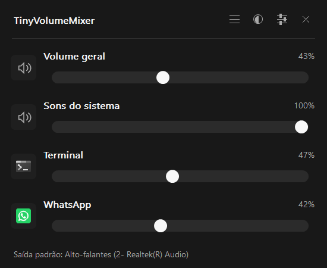

# TinyVolumeMixer

A small, native volume mixer for Windows 11. Click its tray icon, adjust the sound of an app, and get back to what you were doing.

C++20 · Win32 + Common Controls + GDI+ · Windows Core Audio · MIT

[Guia em português](docs/LEIA-ME.md) · [Architecture](docs/architecture.md) · [Manual checks](docs/testing.md)



[Light theme](docs/screenshots/light-horizontal.png) · [Vertical layout](docs/screenshots/vertical.png) · [Settings](docs/screenshots/settings.png)

## What it does

- Master output volume and mute, plus one control per application.
- A compact popup with light, dark, and automatic Windows themes. Click outside or press Esc to hide it.
- Smooth circular controls and buffered painting; volume updates preserve app labels and icons.
- Horizontal or vertical sliders, with scrolling for longer application lists.
- Global hotkey: **Ctrl + Alt + M** by default, configurable in Settings.
- Optional startup with Windows, disabled by default.
- Live updates when sessions, volumes, or the default multimedia output change.
- One portable x64 executable. No installer, administrator privileges, internet connection, web runtime, or third-party runtime libraries required.

The interface currently uses Brazilian Portuguese. The application adds its **own tray icon**. The master slider controls the default multimedia output; application controls cover sessions on all active outputs. It does not replace the Windows volume icon or change where applications route their audio.

## Use

Download the Windows x64 ZIP from [Releases](https://github.com/Marrkin/tiny-volume-mixer/releases) once a release is published, extract it into a permanent folder, and run `TinyVolumeMixer.exe`. The first launch opens the mixer. Subsequent background launches can use:

```powershell
.\TinyVolumeMixer.exe --background
```

Click the tray icon or press **Ctrl + Alt + M** to toggle the popup. Windows may initially place the icon under the tray overflow arrow. Use the header controls to switch orientation, choose **Automático (Windows)** / **Claro** / **Escuro**, or open Settings. Automatic mode follows the Windows app theme, including changes while the mixer is running; an explicit light/dark choice remains fixed. The tray icon adapts separately to the Windows taskbar theme. Click an application's icon to mute or restore its sound. Raising a slider above zero also unmutes it.

Right-click the tray icon for Settings, a manual device refresh, or **Sair** (Exit). The popup's close button only hides it. Starting another copy opens the existing instance.

Sessions from the same application share a slider across processes and output devices. Packaged apps use their Windows application identity; other apps use the full executable path. Embedded WebView2 audio is attributed to its owning app when that owner can be identified, so unrelated embedded apps are not merged under the WebView2 runtime. If their levels differ, the slider shows the highest level; changing it sets every session in that group to the selected level. A group is shown as muted only when all its sessions are muted. Paused sessions remain available until Windows expires them. Applications without an audio session do not appear. Apps routed to a different active output appear in the same application list. Session reactivation is observed without requiring a manual refresh.

## Build on Windows

Install Visual Studio 2022 with **Desktop development with C++**, a Windows 10/11 SDK, and CMake 3.24 or newer. From a terminal in this directory:

```powershell
cmake --preset windows-x64
cmake --build --preset release
ctest --preset release
.\build\windows-x64\Release\TinyVolumeMixer.exe
```

The MSVC runtime is linked statically (`/MT`). Only Windows system DLLs are required. To produce a portable directory:

```powershell
cmake --install build/windows-x64 --config Release --prefix dist/portable
```

The GitHub Actions workflow builds and tests with MSVC on Windows. It uploads a portable ZIP and SHA-256 checksum. Pushing a version tag such as `v0.2.0` also creates a GitHub Release with those files. Nothing is published by a local build.

Linux contributors can cross-build with [LLVM-MinGW](https://github.com/mstorsjo/llvm-mingw) and Ninja:

```sh
cmake -S . -B build/cross -G Ninja \
  --toolchain cmake/llvm-mingw.cmake \
  -DLLVM_MINGW_ROOT=/path/to/llvm-mingw \
  -DCMAKE_BUILD_TYPE=Release
cmake --build build/cross
```

Run the resulting binaries on Windows. Cross-compilation alone does not validate Core Audio or desktop behavior.

## Preferences and removal

Preferences are stored under `HKCU\Software\TinyVolumeMixer`. `Theme` is a DWORD: `0` follows Windows, `1` selects light, and `2` selects dark. Startup is opt-in and creates only the named `TinyVolumeMixer` value in `HKCU\Software\Microsoft\Windows\CurrentVersion\Run`, pointing to the current executable with `--background`.

To remove the app, disable startup in Settings, choose **Sair**, then delete the executable. You may also remove `HKCU\Software\TinyVolumeMixer` to clear its saved preferences. Move the executable before enabling startup; if you move it later, enable startup again from the new location.

## Resource use

The design is event driven: the UI sleeps in `GetMessage`, and a dedicated COM MTA worker handles Core Audio callbacks and process-exit notifications. There are no polling timers, level meters, background network calls, or bundled web engines. Volume updates repaint only the changed controls/percentage. Existing application rows survive list changes, and icons are loaded only when a new row is needed.

Keep consumption low while prioritizing correct audio discovery and a stable, smooth interface. There is no fixed RAM limit. Measurements should distinguish private memory from working set and be treated as diagnostics rather than a pass/fail budget. See [testing](docs/testing.md) and the [v0.2 validation](docs/validation-v0.2.0.md).

## Contributing

Bug reports should include the Windows build, output device, reproduction steps, and whether switching devices or refreshing the mixer helps. Please keep changes focused on quick access and a small resource footprint.

Licensed under [MIT](LICENSE). Copyright © 2026 Marcos Garcia.
